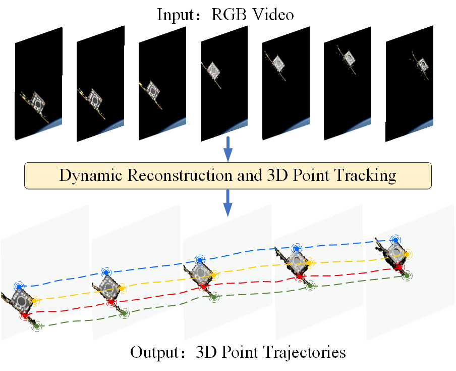
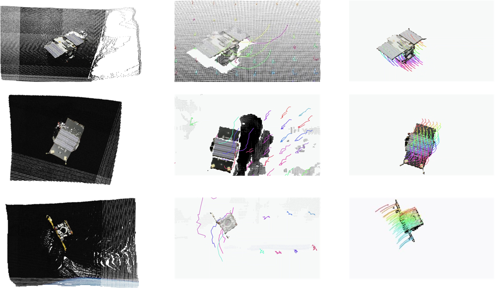

# 4D Spatiotemporal-Aware: 3D Reconstruction and Point Tracking for Space Targets

## Abstract 
Accurate space target surveillance and tracking are critical for enhancing space situational awareness and safeguarding spacecraft operational safety. Conventional 2D tracking methods operate entirely in the image plane, discarding the 3D geometric context of dynamic targets and performing poorly under complex observation conditions. To address this limitation, we propose a 4D spatiotemporal-aware framework for dynamic target reconstruction and 3D point tracking, termed 3D-RPT. Its pipeline consists of four core stages: (i) reconstructing time-varying dynamic 3D pointmaps of the target scene; (ii) extracting multi-scale features to build point-level feature representations; (iii) initializing 3D trajectories and construct tracking Transformer input tokens; (iv) iteratively refining trajectories via a 3D tracking Transformer with interleaved spatial cross-attention and temporal self-attention modules. Evaluated on the SPARK2024 spacecraft trajectory dataset, the proposed framework achieves superior tracking accuracy over competing baselines, providing a valuable reference for non-cooperative target surveillance and collision avoidance tasks.

## Point Tracking Evaluation

